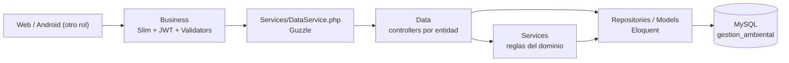
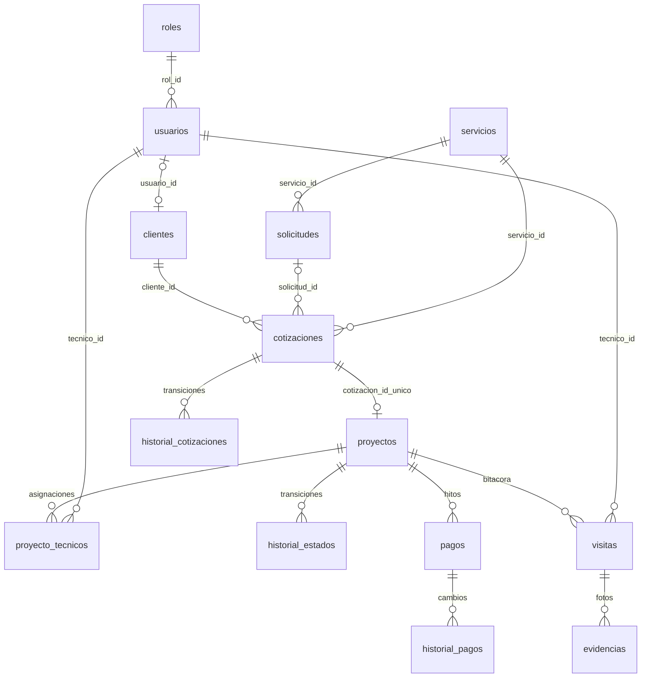

# Backend ambiental: decisiones e integración

## Arquitectura conservada

La base de organización es CitasMedicas. Se copiaron sus puntos de entrada, `.htaccess`, configuración de PDO/Eloquent y cliente `DataService`, y se adaptaron sus patrones de controladores y validadores. `Business/src/app/App.php` sigue registrando Slim, PHP-DI, rutas, JWT y CORS. `Data/src/app/App.php` registra configuración y persistencia. Cada API tiene su `composer.json`, `public/`, `src/app/` y `src/controllers/`.

Los cambios necesarios respecto a la base son las entidades forestales, autorización por registro, servicios de reglas complejas, consultas de repositorio, validación interna, carga de fotos y un canal autenticado entre las APIs. Se corrigieron la ruta `logout`, el nombre SQL `tkRef`, el contrato real de login, el autoload y el tratamiento de refresco/revocación. Son adaptaciones funcionales; se conserva la separación entre Business y Data.

## Modelo de datos

El SQL completo está en `db_dumb/scriptsv.sql`. Las FK, el índice único por cotización/proyecto, los UUID y las transacciones protegen integridad e idempotencia. `actualizaciones/` contiene cambios aditivos para una instalación existente. Las tres familias de historial conservan actor y fecha. Los pagos anulados permanecen en la base.

## Decisiones adoptadas para implementar el plan

El enunciado permite elegir el dominio; estas reglas concretan el correo y el plan del equipo y pueden revisarse con el compañero:

| Tema | Comportamiento implementado |
| --- | --- |
| Roles | Admin = 1, Tecnico = 2, Cliente = 3, conservando el formato `rol_id` de la base. |
| Aprobación | La ejecuta Admin. El cliente consulta su cotización; no aprueba desde un endpoint público. |
| Cotización | Un cliente, un servicio y un monto CRC por oferta; puede partir de solicitud pública o crearse directamente. |
| Proyecto | Se crea únicamente al aprobar una cotización enviada. Repetir devuelve el mismo proyecto. Se puede actualizar su nombre. |
| Flujo | `Cotizacion → Enviada → Aprobada` en la oferta; `Aprobada → En campo → Informe entregado → Facturada` en el proyecto. |
| Salida a campo | Exige al menos un técnico asignado. El anticipo se registra, pero no es un bloqueo obligatorio de salida a campo. |
| Informe | La transición exige `informe_referencia`; es una referencia documental, no un archivo generado por el sistema. |
| Facturación | La transición exige `factura_referencia`; no constituye una integración de factura electrónica ni tributaria. |
| Pagos | Anticipo y Final admiten registros parciales; solo Recibido suma en ingresos. El acumulado no supera la cotización. Final recibido exige Facturada. |
| Edición de pagos | Solo Pendiente se modifica; Recibido se puede anular manteniendo registro e historial. |
| Eliminación | Usuarios, clientes y servicios sin relaciones se eliminan. Relaciones impiden borrar con 409; `activo=false` permite desactivar. Borrar un cliente no elimina su usuario. |
| Visitas | Las crea un técnico asignado. Son inmutables; UUID repetido y contenido equivalente devuelve el mismo registro. |
| Sincronización tardía | Sigue permitida si el técnico está asignado, aunque el proyecto haya avanzado, para conservar capturas offline. |
| Evidencias | Solo el autor de la visita, todavía asignado, adjunta fotos. Admin, técnico asignado y cliente propietario pueden consultarlas. |
| Límites de foto | Hasta cinco por visita, 5 MiB y 25 megapíxeles por foto; JPEG, PNG y WebP, verificados en servidor. |
| Fechas | Entrada ISO 8601 con zona y fracciones opcionales; persistencia y salida en segundos UTC. |
| Montos | Se envían como texto decimal y se calculan en céntimos enteros; almacenamiento DECIMAL(12,2). |
| Sesión | Una sesión activa por usuario, coherente con el único `tkRef` de la base. Login, renovación y logout invalidan los tokens previos de esa sesión. |

La API no implementa registro público de cuentas ni integración bancaria. La solicitud pública captura contacto e interés; Admin asocia el cliente comercial al cotizar. Los pagos son registros de recepción, con referencia.

## Permisos de servidor

| Recurso/operación | Admin | Tecnico | Cliente |
| --- | --- | --- | --- |
| Usuarios, clientes, catálogo privado y solicitudes | Gestión | 403 | 403 |
| Catálogo público y solicitud pública | Sin sesión | Sin sesión | Sin sesión |
| Cotizaciones | Gestión | 403 | Solo propias |
| Proyectos | Todos; asignar, renombrar y cambiar estado | Solo asignados; sin monto | Solo propios |
| Pagos | Registrar, editar pendientes, anular | 403 | Solo propios |
| Crear visitas | 403 | Solo proyectos asignados | 403 |
| Adjuntar fotos | 403 | Solo a visitas propias de proyecto asignado | 403 |
| Leer visitas/fotos | Todos | Proyectos asignados | Proyectos propios |
| Reporte de ingresos | Todos | 403 | Solo propios |
| Otros reportes | Todos | Solo asignados | Solo propios |

Sin JWT se devuelve 401. Un rol sin permiso devuelve 403. Un registro fuera del alcance se presenta como 404. Data exige además `X-Internal-Key`, que Guzzle añade desde la configuración de Business; nunca debe entregarse a frontend. La lectura de roles y sesión se hace con el usuario actual en BD.

## Contratos para el compañero de frontend

Base local: `http://localhost:9091/api`. OpenAPI y ejemplos ejecutables en Swagger: `/api/docs`. Ejemplos REST Client en `Business/RestRequest/`.

`Business/RestRequest/flujo.http` contiene 81 solicitudes positivas numeradas que cubren las 58 operaciones del contrato, incluidos los seis endpoints PUT, los DELETE permitidos, fotos y reintentos de sincronización. Ejecutar cada bloque una vez, en orden, con **Send Request** de REST Client. Cada bloque indica su estado esperado (200 o 201). Para otro recorrido, comenzar desde 01: se generan usuarios, identificadores y datos nuevos. Los DELETE usan registros temporales sin relaciones; el escenario comercial se conserva y suma CRC 150000 en pagos recibidos. Repetir estados o crear nuevamente pagos del mismo proyecto puede producir los conflictos previstos por sus reglas.

La comprobación automatizada del mismo archivo es `Business/tests/flujo-http.php`: ejecuta dos recorridos, comprueba estados HTTP, cobertura del contrato, reintentos sin duplicados, descarga de la foto e ingresos. Ejecutarla únicamente sobre una base de pruebas. En un contenedor Business aislado, después de copiar `Business/RestRequest` a `/tmp/RestRequest`, usar `php tests/flujo-http.php /tmp/RestRequest/flujo.http http://localhost/api`.

- Login: `POST /auth/login` con `username` y `password`. Devuelve `token`, `tkRef`, `expires_in`, `user`; conserva claims `sub`, `username`, `rol_id`, `exp`.
- Renovación: `POST /auth/refresh` con `tkRef`. Rota acceso/refresco. Un token de refresco ya usado no se acepta de nuevo.
- Cierre: `DELETE /auth/logout/{id}`. Solo el propio usuario; revoca acceso y refresco. Se corrigió el nombre `loggout` de la base.
- Sesión: `GET /auth/me`; ni login ni este endpoint exponen hash, `tkRef` almacenado o identificador de sesión.
- CRUD: `/usuario`, `/cliente`, `/servicio`, `/cotizacion`, `/pago`, con los métodos y restricciones de OpenAPI.
- Listados: `GET /entidad/filter/{offset}/{limit}`. Respuesta `data` y `pagination {offset, limit, total}`. `GET /entidad` devuelve la primera página de 20.
- Proyecto: se crea por aprobación; `PUT /proyecto/{id}` cambia el nombre y `POST /proyecto/{id}/estado` avanza su flujo. No hay borrado de proyectos con historial.
- Error general: `{ "error": "Mensaje" }`. Validación por campos: `{ "errors": { "campo": "Mensaje" } }`.

### Protocolo de campo

1. El móvil descarga previamente los proyectos asignados y guarda localmente su información.
2. Genera un UUID estable por visita y por foto; conserva los UUID y los bytes al reintentar.
3. Guarda localmente proyecto, fecha de captura, observaciones, latitud, longitud y fotos. La persistencia local y la cámara pertenecen al frontend móvil.
4. Cuando recupera red y sesión, envía `POST /visita`. Primera aceptación: 201 con `data.id`; reintento equivalente: 200 con `repetido=true`; contenido diferente para el UUID: 409.
5. Si se perdió la respuesta, puede consultar `GET /visita/uuid/{uuid}`.
6. Envía cada foto con `POST /visita/{id}/evidencia`, multipart con `uuid` y `archivo`. Reintento de los mismos bytes: 200; otros bytes para el UUID: 409.
7. El detalle de la visita incluye las evidencias ya recibidas; la descarga autorizada usa `GET /evidencia/{id}`.
8. El móvil marca sincronizada la visita solo cuando se confirmaron metadatos y todas sus fotos. Ante 401, reautentica o renueva antes de continuar; ante 409 muestra el conflicto y conserva la copia local.

Fotos y GPS se validan y persisten en backend. Esto no demuestra aún una captura real en modo avión ni la persistencia de la cola Android: se verifican al integrar F06/F07.

## Reportes

| Endpoint | Agregación y filtros |
| --- | --- |
| `/reporte/ingresos` | Suma de Recibido por servicio/cliente y moneda; fechas filtran fecha_pago. |
| `/reporte/proyectos-estado` | Conteo por estado actual; cliente, servicio y proyecto opcionales. |
| `/reporte/visitas` | Conteo por proyecto; fechas filtran fecha_captura. El listado está en `/visita/filter/...`. |
| `/reporte/mapa` | Coordenadas, fecha, UUID y proyecto de visitas sincronizadas. |

Los cuatro admiten `cliente_id`, `servicio_id`, `proyecto_id`, `offset` y `limit`. Los tres reportes con fechas admiten `desde` y `hasta` inclusivos en ISO 8601. El total se calcula sobre los grupos antes de paginar. Frontend debe solicitar todas las páginas necesarias para el mapa y construir los gráficos/exportaciones.

## Pendientes fuera del backend local

- Revisión conjunta del contrato y conexión con F01–F09.
- Construcción del cliente web y APK por el otro rol; integración de `webpresentacion` en Compose.
- Prueba real cámara/GPS/cola offline en Android, incluidas interrupciones de red.
- Despliegue Cloud con dominio/HTTPS, secretos propios, respaldo y restauración de MySQL/fotos. No utilizar las cuentas ficticias en producción.
- Manual de usuario ilustrado, video y defensa. El backend no genera estos entregables automáticamente.

El puerto de Data y el de MySQL se limitan a localhost en desarrollo. En Cloud pueden omitirse sus publicaciones y mantenerlos solo en la red interna de Compose; la entrada externa debe pasar por HTTPS hacia Business.
